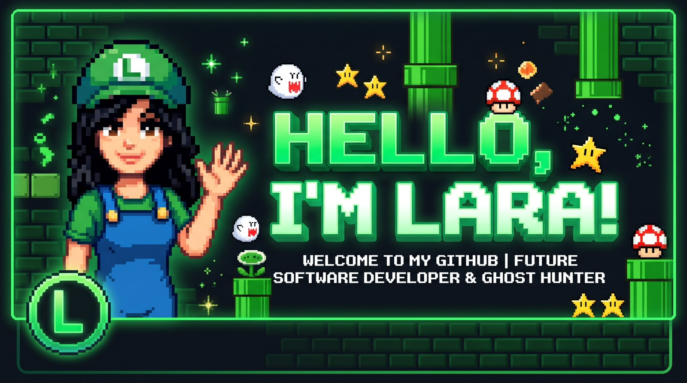
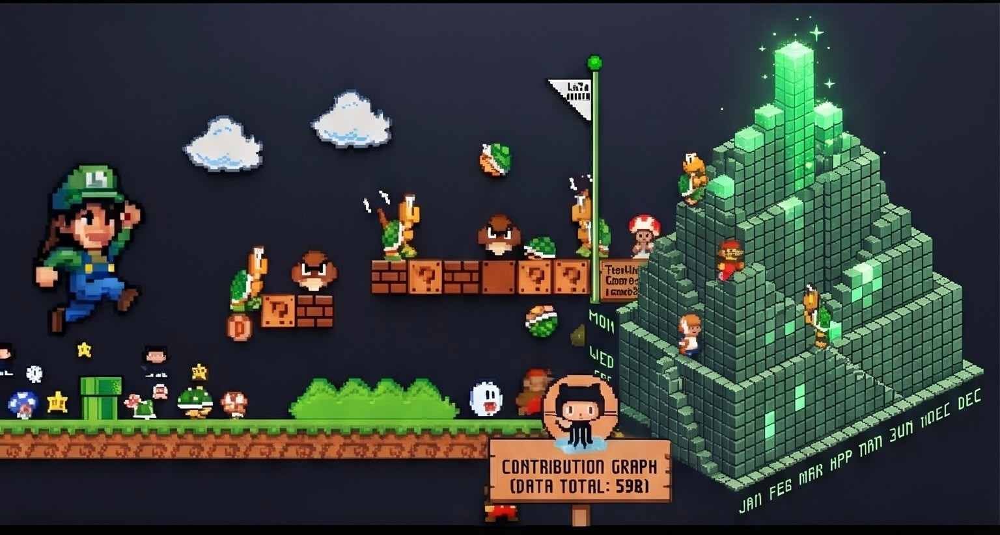

  

Desenvolvedora de Software em formação • Estudante de Análise e Desenvolvimento de Sistemas • Foco em Web e IA. Construindo experiência em Back-end e Engenharia de IA.

> *"I ain't afraid of no code, or ghosts!"* 👻

## 💚 Connect with Lara

  
  

## 🍄 Lara's Tech Stack

## 💥 Lara's GitHub Analytics

  
  

## ⭐ Lara Caçando Contribuições

## 🏆 Lara's Achievements

## 🌼 Lara's Dev Quote

> Ainda estou construindo experiência, mas são caminhos que fazem sentido para mim." />

